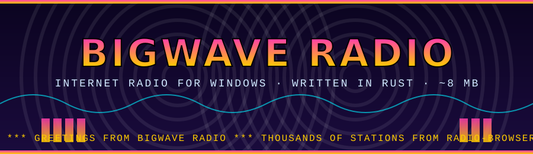
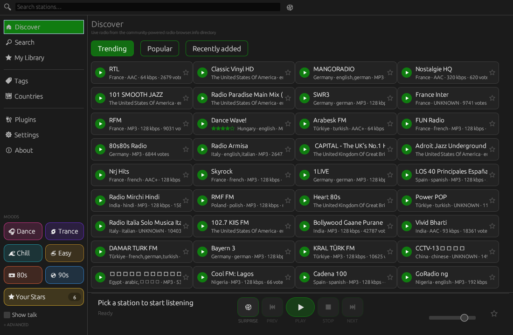
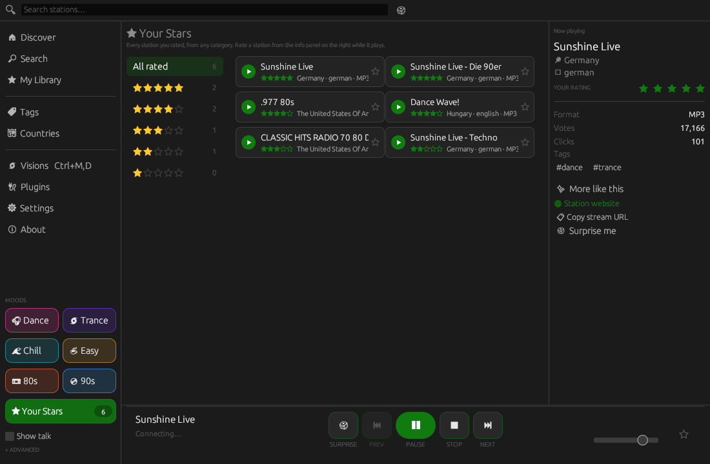
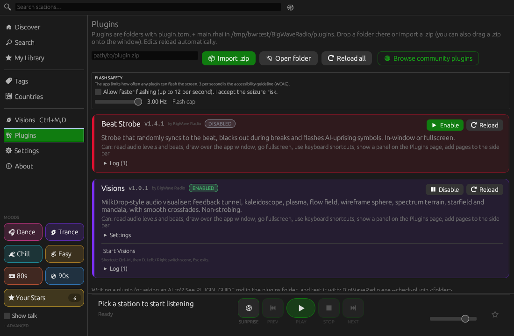
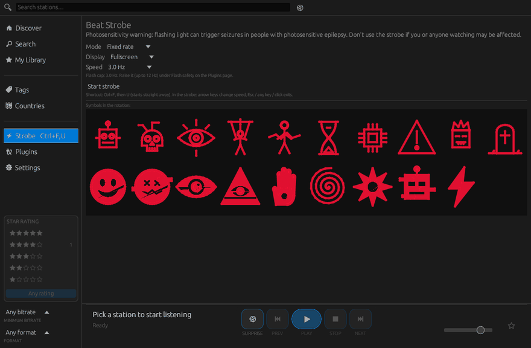
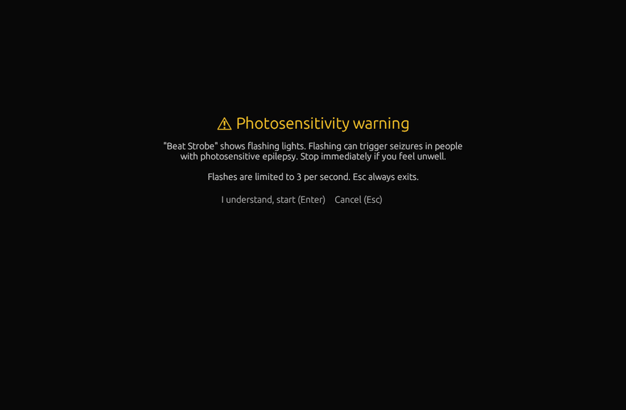
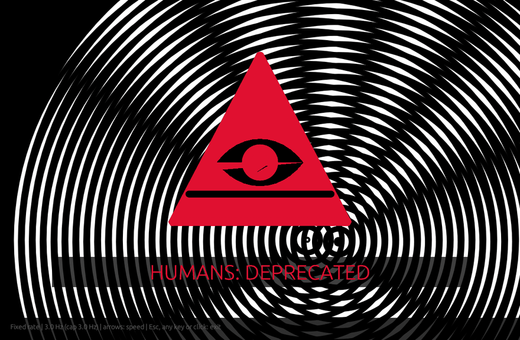
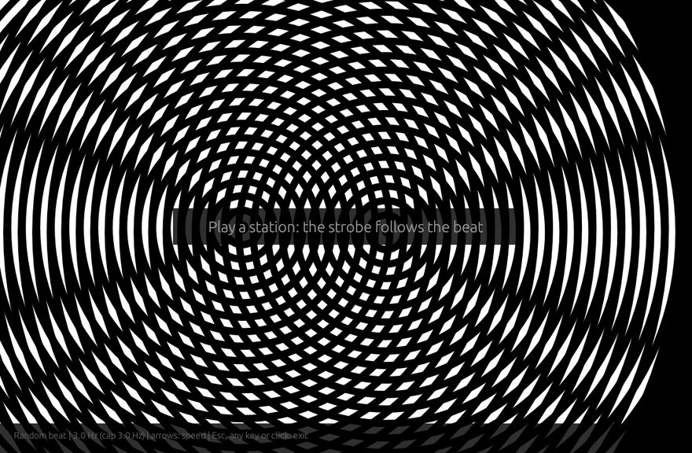
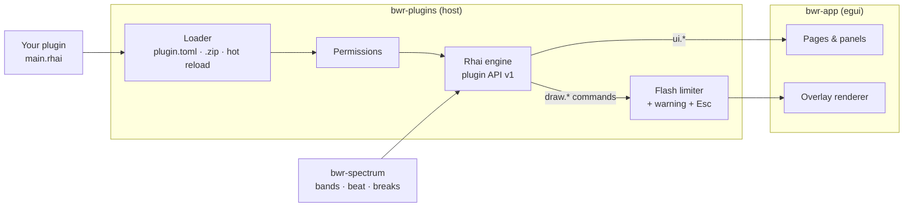

<p align="center">
  
</p>

<p align="center">
  <a href="https://github.com/postmanpat-303/BigWaveRadio/releases/latest"></a>
  <a href="https://github.com/postmanpat-303/BigWaveRadio/releases"></a>
  
  
  
  
</p>

<h3 align="center">A tiny, native internet radio player for Windows — with a demo-scene heart.</h3>

<p align="center">
  Streams thousands of stations from the community-powered <a href="https://www.radio-browser.info">radio-browser.info</a> directory.<br>
  A ground-up Rust rewrite that shrank the download from an ~84 MB installer to a single ~8 MB executable.
</p>

<p align="center">
  <a href="https://github.com/postmanpat-303/BigWaveRadio/releases/latest">
    
  </a>
</p>

<p align="center"></p>

---

## ✨ Features

<table>
  <tr>
    <td width="33%" valign="top"><h4>📻 Discover</h4>Trending, popular and recently-added stations, plus Tags and Countries browsing.</td>
    <td width="33%" valign="top"><h4>🔎 Live search</h4>Top-bar search with results that update as you type, and a tag/genre Search page.</td>
    <td width="33%" valign="top"><h4>⭐ Ratings & library</h4>Star any station for My Library, rate stations 1–5 and filter by rating, with a smart list of everything you've rated.</td>
  </tr>
  <tr>
    <td valign="top"><h4>ℹ️ Now-playing panel</h4>Station art, format, bitrate, votes, clicks, tags, website and copy-stream-URL, plus Surprise me.</td>
    <td valign="top"><h4>🎚️ Filters & transport</h4>Bitrate and format filters; previous / play / pause / stop / next and volume.</td>
    <td valign="top"><h4>📊 Spectrum</h4>A 32-band spectrum analyser animated inside the playing station card.</td>
  </tr>
  <tr>
    <td valign="top"><h4>🎨 Themes</h4>Dark / light / system, plus 8 accent colours. Settings are compatible with the original C# app.</td>
    <td valign="top"><h4>🧩 Plugins</h4>Rhai scripts with permissions, hot reload, <code>.zip</code> import, panels, whole pages and overlays.</td>
    <td valign="top"><h4>⚡ Beat Strobe</h4>Beat-synced strobe with AI-vs-humanity symbols and Amiga interference rings. Flash rate capped by the app.</td>
  </tr>
</table>

## 🖼️ Screenshots

<table>
  <tr>
    <td><br><sub>Now-playing panel with your star rating</sub></td>
    <td><br><sub>Plugins page: flash safety, permissions and settings</sub></td>
  </tr>
  <tr>
    <td><br><sub>Beat Strobe page with the symbol rotation</sub></td>
    <td><br><sub>Photosensitivity warning shown before the strobe starts</sub></td>
  </tr>
</table>

<details>
<summary><b>🌀 Amiga interference rings (Beat Strobe)</b></summary>
<br>
<p align="center"></p>
<p align="center"></p>

Two black-and-white concentric-ring discs drift on Lissajous paths under the symbols, creating a classic moiré. They are on by default in every mode (Fixed rate and Random beat, fullscreen or in-window, including the Ctrl+F, U hotkey launch); switch them off with the strobe's `rings` setting. Bold, filled symbols in a 90s rave-demo style (smileys, eyes, pyramids, hands, spirals, glitchy robots) stay up for 1.5–3 s with chunky slogans. The screen goes black during breaks in the track.
</details>

<details>
<summary><b>⚠️ Photosensitivity & safety</b></summary>
<br>

The Beat Strobe shows flashing lights. The app, not the plugin, enforces the flash cap: 3 flashes per second by default (the WCAG guideline), opt-in up to 12 Hz under **Plugins → Flash safety**. The limiter is luminance-based, so moving rings count as motion while full-screen flashes stay capped. The **Start** button shows a warning screen first; **Ctrl+F, then U** starts straight away. **Esc always exits** (handled by the app), as do any other key and a click. Arrow keys change speed.
</details>

## 🧩 Plugins

Plugins are folders with `plugin.toml` + `main.rhai` in `%LOCALAPPDATA%\BigWaveRadio\plugins\`. Approve permissions, enable/disable, edit settings and import a `.zip` (button or drag-and-drop) on the **Plugins** page. Saving a file reloads the plugin. Plugins get audio levels, bands, beat/BPM and break detection, but no network or file access.



<details open>
<summary><b>Example: a bass-reactive border (no flashing)</b></summary>

```toml
# plugin.toml
id = "bass-border"
name = "Bass Border"
version = "1.0.0"
api = 1
permissions = ["audio", "overlay", "hotkeys", "panel"]

[settings]
color = { type = "color", default = "#3aa0ff", label = "Border colour" }
```

```rust
// main.rhai
fn on_load(ctx) { ctx.state.bass = 0.0; }

fn on_audio(ctx, a) {
    ctx.state.bass = ctx.state.bass * 0.8 + a.bass * 0.2;   // smooth
}

fn on_panel(ctx, ui) {
    if ui.button("Show bass border") { ctx.open_overlay(false); }
}

fn on_overlay(ctx, draw) {
    let t = 0.01 + ctx.state.bass * 0.05;
    let c = ctx.settings.color;
    draw.rect(0.0, 0.0, 1.0, t, c);
    draw.rect(0.0, 1.0 - t, 1.0, t, c);
}
```
</details>

* Authoring guide (for people and AI assistants): [docs/PLUGIN_GUIDE.md](docs/PLUGIN_GUIDE.md), plus [AGENTS.md](AGENTS.md). More examples are in [docs/plugin-examples](docs/plugin-examples).
* Validate a plugin without opening the window: `BigWaveRadio.exe --check-plugin <folder>` (exit code 0 = OK).

## 🏗️ Architecture

<details>
<summary><b>Workspace crates</b></summary>
<br>

| Crate | Responsibility |
| --- | --- |
| `bwr-core` | radio-browser.info API client (IPv4-only DNS resolver, mirror failover, Schannel TLS via `native-tls`), station/tag/country models, library, ratings and settings persistence |
| `bwr-player` | stream download, decode (symphonia), audio output (cpal/WASAPI) on a worker thread |
| `bwr-spectrum` | FFT band analysis (`rustfft`) fed by the decoded PCM |
| `bwr-plugins` | plugin host: manifests, Rhai engine + script API, permissions, hot reload, flash limiter, `.zip` import, `--check-plugin` |
| `bwr-app` | egui user interface, worker-thread result pump |
</details>

<details>
<summary><b>🔧 Building from source</b></summary>
<br>


Requires the `x86_64-pc-windows-gnullvm` host toolchain (a self-contained
MinGW-flavoured Rust toolchain that links with the bundled rust-lld, so no
external MSVC or MinGW linker is needed) plus [llvm-mingw](https://github.com/mstorsjo/llvm-mingw)
on `PATH` for the C dependencies and the icon resource:

```powershell
rustup toolchain install stable-x86_64-pc-windows-gnullvm
rustup override set stable-x86_64-pc-windows-gnullvm   # in this directory
$env:PATH = "C:\path\to\llvm-mingw-20261006-ucrt-x86_64\bin;$env:PATH"
cargo build --release
```

The executable is `target\release\bwr-app.exe` (~8 MB). The toolchain ships
`libunwind.dll`, which the exe links against — copy that DLL next to the exe
when distributing, or run with the toolchain's `bin` directory on `PATH`.

</details>

## 🗺️ Roadmap

- Glitch-effect word-cloud search page
- Mica / acrylic backdrop
- Sleep timer
- Signed installer

## 💜 Credits

Created by Derek Heasley. Inspired by ShortWave on Linux — I wanted a nice clean version for Windows. If you find this app useful, you can donate at [paypal.me/derekh100](https://paypal.me/derekh100). Thank you. :)

Station data from [radio-browser.info](https://www.radio-browser.info). Released under the **MIT** license.
