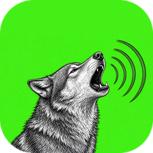
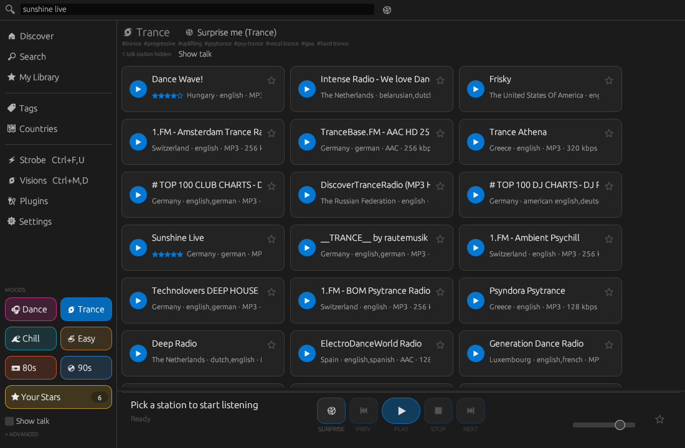
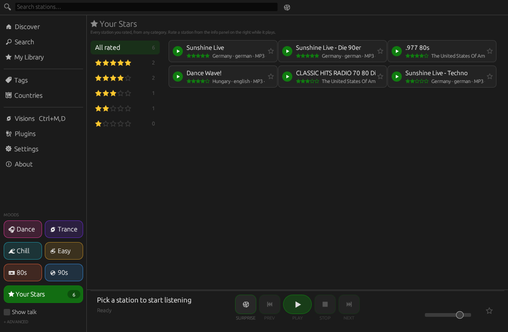
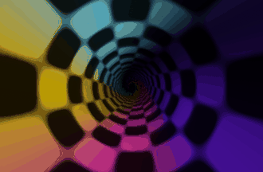
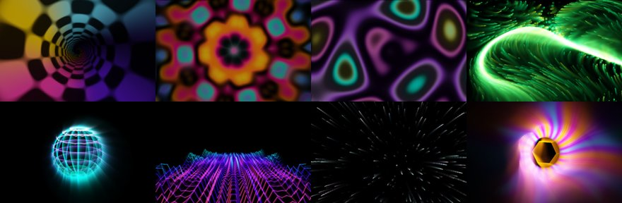
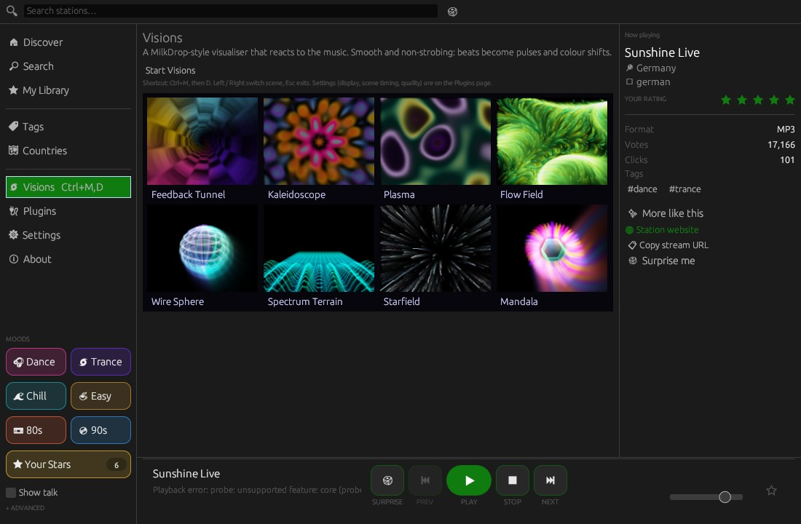
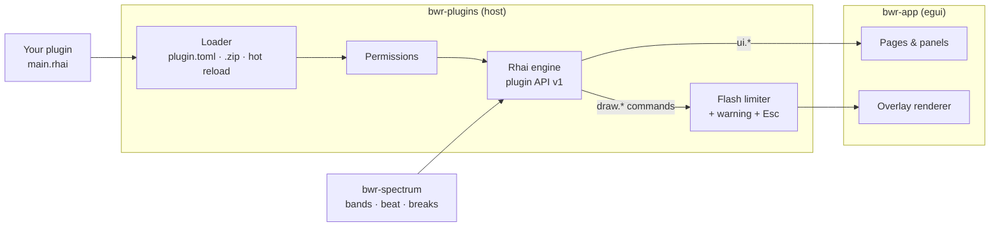

<p align="center">
  
</p>

<p align="center">
  
</p>

<p align="center">
  <a href="https://github.com/postmanpat-303/BigWaveRadio/releases/latest"></a>
  <a href="https://github.com/postmanpat-303/BigWaveRadio/releases"></a>
  
  <a href="#downloads"></a>
  <a href="#downloads"></a>
  
  
  
  <a href="https://buymeacoffee.com/postmanpat"></a>
</p>

<h3 align="center">A tiny, native internet radio player for Windows, macOS and Linux — with a demo-scene heart.</h3>

<p align="center">
  Streams thousands of stations from the community-powered <a href="https://www.radio-browser.info">radio-browser.info</a> directory.<br>
  A ground-up Rust rewrite that shrank the download from an ~84 MB installer to a single ~8 MB executable.
</p>

<p align="center">
  🐺 Part of the Wave family: <b>BigWave Radio</b> · <a href="https://github.com/postmanpat-303/ChipWaveTracker"><b>ChipWave Tracker</b></a> (an OctaMED-inspired music tracker) · <a href="https://github.com/postmanpat-303/StreamWave"><b>StreamWave</b></a> (an audio recorder and editor for streamers and podcasters)
</p>

<p align="center">
  <a href="https://github.com/postmanpat-303/BigWaveRadio/releases/latest">
    
  </a>
</p>

<p align="center"></p>

<a id="downloads"></a>

## ⬇️ Downloads

Get them from the [latest release](https://github.com/postmanpat-303/BigWaveRadio/releases/latest) (`<ver>` is the version, e.g. `0.9.6`):

> [!IMPORTANT]
> **🗣️ Feedback highly recommended!** The macOS and Linux builds are brand new and haven't been tested on real machines yet (only on build servers). If you try one, please tell me how it went, good or bad: [report a problem](https://github.com/postmanpat-303/BigWaveRadio/issues/new?template=bug_report.yml) or say [it works on my system](https://github.com/postmanpat-303/BigWaveRadio/issues/new?template=works_for_me.yml). Questions and ideas are welcome in [Discussions](https://github.com/postmanpat-303/BigWaveRadio/discussions). Thank you!

| OS | File | Notes |
| --- | --- | --- |
| **Windows 10/11** (x64) | `BigWaveRadio-<ver>-setup-x64.exe` | Installer (recommended). Tray icon, media keys, Ctrl+Alt+B |
| | `BigWaveRadio-<ver>-windows-x64.zip` | Portable, no install |
| **macOS 11+** (Apple Silicon + Intel) | `BigWaveRadio-<ver>-macos-universal.dmg` | Open it, drag **BigWave Radio** to **Applications** |
| | `BigWaveRadio-<ver>-macos-universal.zip` | The same `.app`, zipped |
| **Ubuntu / Debian / Mint / Pop!_OS** | `BigWaveRadio-<ver>-linux-x86_64.deb` (or `-aarch64.deb`) | `sudo apt install ./BigWaveRadio-<ver>-linux-x86_64.deb` |
| **Fedora 36+** (RHEL 9 is too old: glibc 2.34) | `BigWaveRadio-<ver>-linux-x86_64.rpm` (or `-aarch64.rpm`) | `sudo dnf install ./BigWaveRadio-<ver>-linux-x86_64.rpm` |
| **Arch / CachyOS / Manjaro / EndeavourOS** | `BigWaveRadio-<ver>-linux-x86_64.pkg.tar.zst` | `sudo pacman -U ./BigWaveRadio-<ver>-linux-x86_64.pkg.tar.zst`, or build it yourself with [`packaging/arch`](packaging/arch) (`makepkg -si`) |
| **Any Linux** (glibc 2.35+) | `BigWaveRadio-<ver>-linux-x86_64.AppImage` (or `-aarch64`) | `chmod +x` it and run it. Needs `libfuse2`, or set `APPIMAGE_EXTRACT_AND_RUN=1` |
| | `BigWaveRadio-<ver>-linux-x86_64.tar.gz` (or `-aarch64`) | Unpack and run `./bigwave-radio`, or `./install.sh` to add it to your menu (per user, no root) |

<details>
<summary><b>🍎 macOS: first launch (Gatekeeper)</b></summary>
<br>

The app is ad-hoc signed but not notarised by Apple, so the first time macOS says it "can't be opened" or "cannot verify the developer". Either:

* **Right-click** (or Control-click) **BigWave Radio** in Applications → **Open** → **Open**. You only need to do this once; or
* in Terminal: `xattr -dr com.apple.quarantine "/Applications/BigWave Radio.app"`

On macOS 15 and later, if there's no **Open** button, go to **System Settings → Privacy & Security** and click **Open Anyway** after the first try.
</details>

<details>
<summary><b>🐧 Linux notes</b></summary>
<br>

* Every package installs the `bigwave-radio` command, a menu entry and the wolf icon (hicolor theme).
* Runs on X11 and Wayland. Audio goes through ALSA, so PipeWire and PulseAudio systems work via their ALSA plugin (installed by default on desktop distros).
* There's no tray icon on Linux or macOS yet: closing the window quits. Media keys / Ctrl+Alt+B are Windows-only for now.
</details>

**Where your data lives** (stations, ratings, settings, plugins):

| OS | Folder |
| --- | --- |
| Windows | `%LOCALAPPDATA%\BigWaveRadio` |
| macOS | `~/Library/Application Support/BigWaveRadio` |
| Linux | `$XDG_DATA_HOME/BigWaveRadio` (usually `~/.local/share/BigWaveRadio`) |

The app checks for updates (About → **Check for updates**) and offers the download that matches your system: the setup on Windows, the dmg on macOS, and the same package type you installed on Linux.

## 📺 Watch the promo

<p align="center">
  <video src="docs/media/promo.mp4" width="880" controls muted playsinline></video><br>
  <sub>45-second tour: Discover, mood chips, Your Stars, Visions, Beat Strobe and plugins — with narration. <a href="docs/media/promo.mp4">Open the video file</a>.</sub>
</p>

---

## ✨ Features

<table>
  <tr>
    <td width="33%" valign="top"><h4>📻 Discover</h4>Trending, popular and recently-added stations, Tags browsing, and a world map with station bubbles for each country.</td>
    <td width="33%" valign="top"><h4>🎧 Mood chips</h4>One click for <b>Dance, Trance, Chill, Easy, 80s or 90s</b>. Each mood searches several radio-browser tags at once (trance covers progressive, uplifting, psytrance…). The mappings live in an editable <code>moods.json</code>.</td>
    <td width="33%" valign="top"><h4>⭐ Your Stars</h4>Rate stations 1–5 from the now-playing panel. <b>Your Stars</b> lists every station you rated, from any category, by star level or all sorted by stars.</td>
  </tr>
  <tr>
    <td valign="top"><h4>🔎 Music-first search</h4>Live top-bar search with one-click history. Results are ranked with working streams first, then votes, clicks and bitrate, and near-identical stations are merged. Talk, news, sport and religious stations are hidden unless you tick <b>Show talk</b>.</td>
    <td valign="top"><h4>✨ More like this · 🎲 Surprise me</h4>Find stations that share the playing station's tags, weighted by your ratings, or get a well-rated or popular pick within your moods. <b>Recently played</b> sits in My Library.</td>
    <td valign="top"><h4>🗂️ Compact station grid</h4>Tight cards that fit about twice as many stations on screen, with columns that follow the window width. Prefer roomier cards? Switch to <b>Comfortable</b> in Settings. A 32-band spectrum animates inside the playing card.</td>
  </tr>
  <tr>
    <td valign="top"><h4>ℹ️ Now-playing panel</h4>Station art, format, bitrate, votes, clicks, tags, website and copy-stream-URL.</td>
    <td valign="top"><h4>🎚️ Transport & Advanced</h4>Previous / play / pause / stop / next and volume. Format and minimum-bitrate filters sit under <b>Advanced</b> in the left rail.</td>
    <td valign="top"><h4>💾 Your data</h4><code>settings.json</code> stays compatible with the original C# app. New state goes in <code>discovery.json</code>, <code>moods.json</code> and <code>update.json</code>.</td>
  </tr>
  <tr>
    <td valign="top"><h4>🎨 Themes</h4>Dark / light / system, plus 8 accent colours.</td>
    <td valign="top"><h4>🧩 Plugins</h4>Rhai scripts with permissions, hot reload, <code>.zip</code> import, panels, whole pages and overlays. <b>Double-click</b> a plugin in the side menu to start it. Find more in the <a href="https://github.com/postmanpat-303/BigWaveRadio-Plugins">community plugin hub</a>.</td>
    <td valign="top"><h4>⚡ Beat Strobe & 🌌 Visions</h4>Beat-synced strobe with AI-vs-humanity symbols and Amiga interference rings (flash rate capped by the app), plus a smooth MilkDrop-style visualiser with eight scenes, now rendered sharper (360p engine, adjustable quality).</td>
  </tr>
  <tr>
    <td valign="top"><h4>🔄 Update checker</h4><b>Check for updates</b> on the About page shows what's new and links straight to the new installer. A quiet check at startup (at most once a day, switch it off in Settings) shows a small notice when a new version is out. Nothing installs by itself.</td>
    <td valign="top"></td>
    <td valign="top"></td>
  </tr>
</table>

## 🖼️ Screenshots

<table>
  <tr>
    <td><br><sub>Mood chips: Trance, talk stations hidden</sub></td>
    <td><br><sub>Your Stars: every rated station, by level</sub></td>
  </tr>
  <tr>
    <td><br><sub>Now-playing panel with your star rating</sub></td>
    <td><br><sub>Plugins page: tinted cards, flash safety, permissions and settings</sub></td>
  </tr>
  <tr>
    <td><br><sub>Beat Strobe page with the symbol rotation</sub></td>
    <td><br><sub>Photosensitivity warning shown before the strobe starts</sub></td>
  </tr>
</table>

<details>
<summary><b>🌀 Amiga interference rings (Beat Strobe)</b></summary>
<br>
<p align="center"></p>
<p align="center"></p>

Two black-and-white concentric-ring discs drift on Lissajous paths under the symbols, creating a classic moiré. They are on by default in every mode (Fixed rate and Random beat, fullscreen or in-window, including the Ctrl+F, U hotkey launch); switch them off with the strobe's `rings` setting. Bold, filled symbols in a 90s rave-demo style (smileys, eyes, pyramids, hands, spirals, glitchy robots) change every 0.5 s by default (Symbol duration: 0.5, 1, 1.5, 2, 3 s or random 1.5–3 s) with chunky slogans. Optional **Fade to black** (Off by default; 1–15 s hold) smoothly fades the strobe out after a chosen on time (5–60 s), holds, and fades back in. The screen goes black during breaks in the track.
</details>

<details>
<summary><b>⚠️ Photosensitivity & safety</b></summary>
<br>

The Beat Strobe shows flashing lights. The app, not the plugin, enforces the flash cap: 3 flashes per second by default (the WCAG guideline), opt-in up to 12 Hz under **Plugins → Flash safety**. The limiter is luminance-based, so moving rings count as motion while full-screen flashes stay capped. The **Start** button shows a warning screen first; **Ctrl+F, then U** starts straight away. **Esc always exits** (handled by the app), as do any other key and a click. Arrow keys change speed.
</details>

## 🌌 Visions — MilkDrop-style visualiser

<p align="center"></p>

A bundled, non-strobing visualiser in the spirit of Winamp MilkDrop / AVS. It reacts to the music (level, bass / mid / treble, beats and the 32-band spectrum) and glides between eight scenes with smooth crossfades:

<table>
  <tr>
    <td>🌀 <b>Feedback Tunnel</b></td><td>🔷 <b>Kaleidoscope</b></td><td>🫧 <b>Plasma</b></td><td>🌿 <b>Flow Field</b></td>
  </tr>
  <tr>
    <td>🌐 <b>Wire Sphere</b></td><td>⛰️ <b>Spectrum Terrain</b></td><td>✨ <b>Starfield</b></td><td>🌸 <b>Mandala</b></td>
  </tr>
</table>

<p align="center"></p>

* **Ctrl+M, then D** starts it from anywhere (or use the **Visions** page, which shows live previews of every scene). In-window or fullscreen.
* **Left / Right** switch scene; **Esc**, any other key or a click exits.
* Scenes change every 10–60 s (or never), and optionally on strong beats. Quality and intensity are adjustable under Plugins → Visions → Settings.
* Beats become gentle pulses and colour shifts, never flashes: the native engine limits how fast overall brightness can change.
* Built on the new `draw.visual` plugin primitive: a fast native feedback renderer (zoom / rotate / warp / decay of the previous frame) that any plugin can drive from Rhai with its own palettes, motion and audio mapping. See the [plugin guide](docs/PLUGIN_GUIDE.md).

<details>
<summary><b>Visions page with live scene previews</b></summary>
<br>
<p align="center"></p>
</details>

## 🧩 Plugins

Plugins are folders with `plugin.toml` + `main.rhai` in the `plugins` folder of your data directory: `%LOCALAPPDATA%\BigWaveRadio\plugins\` on Windows, `~/Library/Application Support/BigWaveRadio/plugins/` on macOS, `~/.local/share/BigWaveRadio/plugins/` on Linux. Approve permissions, enable/disable, edit settings and import a `.zip` (button or drag-and-drop) on the **Plugins** page. Saving a file reloads the plugin. Plugins get audio levels, bands, beat/BPM and break detection, but no network or file access.



<details open>
<summary><b>Example: a bass-reactive border (no flashing)</b></summary>

```toml
# plugin.toml
id = "bass-border"
name = "Bass Border"
version = "1.0.0"
api = 1
permissions = ["audio", "overlay", "hotkeys", "panel"]

[settings]
color = { type = "color", default = "#3aa0ff", label = "Border colour" }
```

```rust
// main.rhai
fn on_load(ctx) { ctx.state.bass = 0.0; }

fn on_audio(ctx, a) {
    ctx.state.bass = ctx.state.bass * 0.8 + a.bass * 0.2;   // smooth
}

fn on_panel(ctx, ui) {
    if ui.button("Show bass border") { ctx.open_overlay(false); }
}

fn on_overlay(ctx, draw) {
    let t = 0.01 + ctx.state.bass * 0.05;
    let c = ctx.settings.color;
    draw.rect(0.0, 0.0, 1.0, t, c);
    draw.rect(0.0, 1.0 - t, 1.0, t, c);
}
```
</details>

* Authoring guide (for people and AI assistants): [docs/PLUGIN_GUIDE.md](docs/PLUGIN_GUIDE.md), plus [AGENTS.md](AGENTS.md). More examples are in [docs/plugin-examples](docs/plugin-examples).
* Validate a plugin without opening the window: `BigWaveRadio.exe --check-plugin <folder>` (`bigwave-radio --check-plugin` on Linux, `"/Applications/BigWave Radio.app/Contents/MacOS/BigWaveRadio" --check-plugin` on macOS; exit code 0 = OK), or the standalone Linux `bwr-plugin-check` attached to each release.
* 🌐 **Community plugins:** browse and share plugins at [BigWaveRadio-Plugins](https://github.com/postmanpat-303/BigWaveRadio-Plugins) (linked from the Plugins page). Each plugin card on the Plugins page gets its own colour; set `accent = "#rrggbb"` in `plugin.toml` to choose it.

## 🏗️ Architecture

<details>
<summary><b>Workspace crates</b></summary>
<br>

| Crate | Responsibility |
| --- | --- |
| `bwr-core` | radio-browser.info API client (IPv4-only DNS resolver, mirror failover, native TLS via `native-tls` (Schannel / Secure Transport / OpenSSL)), station/tag/country models, library, ratings and settings persistence |
| `bwr-player` | stream download, decode (symphonia), audio output (cpal: WASAPI / CoreAudio / ALSA) on a worker thread |
| `bwr-spectrum` | FFT band analysis (`rustfft`) fed by the decoded PCM |
| `bwr-plugins` | plugin host: manifests, Rhai engine + script API, permissions, hot reload, flash limiter, `.zip` import, `--check-plugin` |
| `bwr-app` | egui user interface, worker-thread result pump |
</details>

<details>
<summary><b>🔧 Building from source</b></summary>
<br>


Requires the `x86_64-pc-windows-gnullvm` host toolchain (a self-contained
MinGW-flavoured Rust toolchain that links with the bundled rust-lld, so no
external MSVC or MinGW linker is needed) plus [llvm-mingw](https://github.com/mstorsjo/llvm-mingw)
on `PATH` for the C dependencies and the icon resource:

```powershell
rustup toolchain install stable-x86_64-pc-windows-gnullvm
rustup override set stable-x86_64-pc-windows-gnullvm   # in this directory
$env:PATH = "C:\path\to\llvm-mingw-20261006-ucrt-x86_64\bin;$env:PATH"
cargo build --release
```

The executable is `target\release\bwr-app.exe` (~8 MB). The toolchain ships
`libunwind.dll`, which the exe links against — copy that DLL next to the exe
when distributing, or run with the toolchain's `bin` directory on `PATH`.

**Release packaging** (same flow as [ChipWave Tracker](https://github.com/postmanpat-303/ChipWaveTracker)):
on Linux with llvm-mingw and NSIS (`makensis`) installed, run

```bash
scripts/package-windows.sh 0.9.6
```

It writes `dist/BigWaveRadio-<ver>-windows-x64.zip` (portable) and
`dist/BigWaveRadio-<ver>-setup-x64.exe` (NSIS installer, built from
`installer/bigwave.nsi`). See [docs/PACKAGING.md](docs/PACKAGING.md).

**macOS and Linux** build natively with plain `cargo build --release -p bwr-app`
(Linux needs `libasound2-dev libssl-dev libxkbcommon-dev libwayland-dev libx11-dev libgl1-mesa-dev`
or your distro's equivalents). The release packages come from GitHub Actions:
[`.github/workflows/macos.yml`](.github/workflows/macos.yml) (`scripts/package-macos.sh`: universal
`.app`, dmg, zip) and [`.github/workflows/linux.yml`](.github/workflows/linux.yml)
(`scripts/package-linux.sh` on Ubuntu 22.04: tar.gz, deb, rpm, AppImage, plus the Arch package).

</details>

## 🗺️ Roadmap

- Glitch-effect word-cloud search page
- Mica / acrylic backdrop
- Sleep timer
- Signed installer (Windows) and notarised app (macOS)
- Tray icon and media keys on macOS and Linux

## 💜 Credits

Created by Derek Heasley. Inspired by ShortWave on Linux — I wanted a nice clean version for Windows (and now it runs on macOS and Linux too). If you find this app useful, you can [buy me a coffee](https://buymeacoffee.com/postmanpat) or donate via PayPal at [paypal.me/derekh100](https://paypal.me/derekh100). Thank you. :)

<a href="https://buymeacoffee.com/postmanpat"></a>

Station data from [radio-browser.info](https://www.radio-browser.info). Released under the **MIT** license.

## 💛 Thank you

A big thank you to [storytold](https://github.com/storytold/), whose open-source [PhotoCraft](https://github.com/storytold/photocraft) inspired the look of the Wave family icons, and whose [ArtCraft Launcher](https://github.com/storytold/craft-launcher) inspired the upcoming Wave Hub. Open source at its best. Go give them a ⭐!
